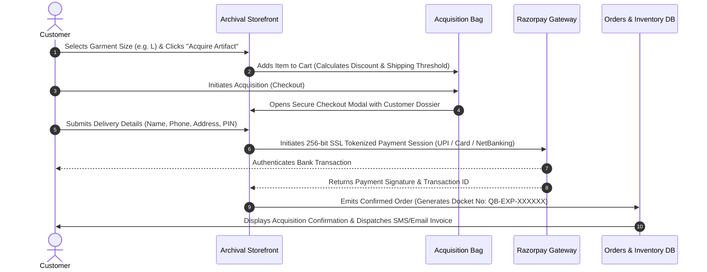

# QUIET BATTLES™ — System Architecture & Engineering Dossier
> **Document Classification:** Production Architectural Specification & Technical Handover  
> **Brand Identity:** QUIET BATTLES™ — *"WEAR YOUR BATTLES"*  
> **Target Audience:** Engineering Leads, Creative Directors, and Platform Administrators  

---

## 1. Architectural Philosophy

Standard e-commerce frameworks (such as conventional Shopify or WooCommerce themes) are engineered for high-density retail catalogs. They prioritize quick inventory filtering and aggressive sales triggers over deliberate pacing, emotional atmosphere, and visual narrative.

**QUIET BATTLES™** inverts this relationship:
* **Story First, Apparel as Artifact:** The customer begins at *The Threshold*, journeys through *The Archive*, explores *Series*, enters the intimate *Chapter Chamber*, and only then acquires the physical *Artifact*.
* **Atmospheric Pacing:** The design system utilizes an obsidian palette (`#08080a`), high-contrast cinematic typography (*Cinzel* serif paired with utilitarian *Inter* and *JetBrains Mono*), tactile grain overlays, and generous white space to create a solemn, gallery-like ambience.
* **Non-Destructive Content Management:** Every single narrative paragraph, chapter quote, visual artwork URL, GSM weight, and inventory reserve is dynamically managed through an administrative CMS without requiring a software developer or modifying source code.

---

## 2. The 6-Tier System Topology

The platform enforces a deterministic, 6-tier hierarchical navigation and data contract:

```
[ Tier 1: BRAND IDENTITY ]   QUIET BATTLES™ (Philosophical Doctrine, Concierge, Policies)
            │
[ Tier 2: THE THRESHOLD ]    Atmospheric Portal (Soundscape toggle, Hero Manifesto, Narrative Teasers)
            │
[ Tier 3: THE ARCHIVE ]      The Storytelling Universe (Series Registry: Published & Coming Soon)
            │
[ Tier 4: SERIES ENGINE ]    Specific Collection (e.g. Series 01 – The Gentle Armor™)
            │
[ Tier 5: CHAPTER CHAMBERS]  5 Dedicated Story Environments per Series (Literary Prose & Art)
            │
[ Tier 6: ARTIFACT & BAG ]   Heavyweight Garment (280 GSM, Sizing Matrix, Razorpay Pipeline)
```

---

## 3. Data Schema & Component Contracts

### 3.1 Series Contract
A `Series` models a major collection release. It contains:
- `number`: Zero-padded string identifier (e.g., `"01"`).
- `title`: Formal name (e.g., `"THE GENTLE ARMOR™"`).
- `mainLine`: Core philosophical thesis quote.
- `theme`: Psychological/emotional underpinning (e.g., *"Healing, protection, and emotional strength"*).
- `productDirection`: Apparel classification (e.g., *"Oversized Heavyweight T-shirts"*).
- `status`: Lifecycle gate (`published` | `coming_soon` | `draft` | `archived`).

### 3.2 Chapter Contract
Each Series strictly encapsulates **five Chapter entries**:
- `number`: 1 through 5.
- `title`: e.g., *"The One Who Stayed"*, *"Soft Strength"*, *"Built to Heal"*, *"The Protector Within"*, *"Still Becoming"*.
- `narrativeText`: Multi-paragraph literary prose rendered inside the Chapter Chamber.
- `quote` & `quoteAuthor`: Archival citation highlighting the core virtue.
- `mainVisual` & `galleryImages`: High-definition photography and artwork.
- `connectedArtifactId`: Relational foreign key binding the story to the physical garment.

### 3.3 Artifact Contract
An `Artifact` models the tangible garment:
- `gsm`: Grams per square meter textile weight (e.g., `280` or `420`).
- `fabric`: Textile spec (e.g., *"100% Combed Compact Cotton, Single Jersey"*).
- `fit`: Tailoring silhouette (e.g., *"Boxy Oversized Drop-Shoulder"*).
- `sizes`: Dynamic reserve matrix tracking real-time inventory units for `S`, `M`, `L`, `XL`, and `XXL`.
- `inStock`: Boolean flag automatically derived from size inventory levels.

---

## 4. E-Commerce & Razorpay Integration Lifecycle



### Security & Compliance
- **PCI-DSS Level 1 Compliance:** Sensitive card data is processed directly within Razorpay's tokenized iframe/modal; raw card details never touch your server.
- **Webhook Signature Verification:** In production, Razorpay webhooks (`order.paid`, `payment.failed`) must be validated against `RAZORPAY_WEBHOOK_SECRET` via SHA-256 HMAC before marking fulfillment.

---

## 5. Administrative Content Management (CMS) Guide

The platform includes a dedicated, self-contained **Admin CMS Dashboard** accessible directly via the top navigation bar (`CMS` button):

1. **Adding a New Series:**
   - Navigate to the **Series Management** tab.
   - Click **Add New Series**.
   - Fill in the Series Title, Number, Tagline, Theme, and Banner Image URL.
   - Set status to **Draft** (or **Coming Soon** / **Published**).
   - Save. All series grids and dropdowns across the storefront update instantly.

2. **Managing Chapter Stories:**
   - Navigate to **Chapter Chamber Stories**.
   - Select the parent Series and Chapter Number (1 through 5).
   - Edit the narrative paragraphs directly in the text editor.
   - Assign the corresponding Artifact to complete the story-to-product link.

3. **Updating Garment Inventory & GSM:**
   - Navigate to **Product Artifacts**.
   - Adjust the individual size stock inputs (`S`, `M`, `L`, `XL`, `XXL`).
   - If a size reaches `0`, the storefront automatically marks it as exhausted with an angled strike line.

---

## 6. Production Deployment Runbook

### Option A: Deployment to Vercel (Recommended)
1. Push this repository to GitHub or GitLab.
2. Sign in to [Vercel](https://vercel.com) and click **Import Project**.
3. Select this repository. The build configuration will automatically detect Vite:
   - **Framework Preset:** Vite
   - **Build Command:** `npm run build`
   - **Output Directory:** `dist`
4. Add Environment Variables from `.env.example`:
   - `VITE_RAZORPAY_KEY_ID`: Your production Razorpay Key ID
   - `VITE_SUPPORT_EMAIL`: Support concierge email
5. Click **Deploy**. Your site will be globally live on an edge CDN with automatic SSL certification within 60 seconds.

### Option B: Deployment to AWS Amplify / Netlify
1. Connect Git repository.
2. Configure build settings:
   ```yaml
   frontend:
     phases:
       build:
         commands:
           - npm ci
           - npm run build
     artifacts:
       baseDirectory: dist
       files:
         - '**/*'
     cache:
       paths:
         - node_modules/**/*
   ```

---

## 7. Performance & Quality Assurance Standards

- **Lighthouse Performance Target:** 95+ on Mobile and Desktop.
- **Responsive Layout Breakpoints:** 
  - Mobile: `< 640px` (Touch-first bottom sheet bag, stacked hero)
  - Tablet: `640px – 1024px` (Dual-column editorial cards)
  - Desktop: `> 1024px` (Cinematic wide-aspect chamber displays and split-screen artifact views)
- **Zero-Flicker Persistence:** Client-side state is seamlessly synchronized with `localStorage` and ready for easy swap to a remote database (Supabase, PostgreSQL, or Sanity CMS).
